<!-- Cabecera animada -->
<p align="center">
  
</p>

<p align="center">
  
</p>

<p align="center">
  <a href="https://github.com/allanze1x-spec">
    
  </a>
</p>

<p align="center">
  
  
  
</p>

---

### Sobre mí

```js
const allan = {
  ciudad: "Barcelona",
  stack: ["JavaScript", "TypeScript", "React", "Node.js", "Python", "SQL"],
  creo: ["páginas web", "aplicaciones", "logotipos"],
  aprendiendo: "IA generativa y Machine Learning con AWS",
  idiomas: ["portugués", "español", "catalán (comprensión)"],
  extra: "experiencia real en reformas, mecánica, reparto y seguridad",
};
```

### Tecnologías

<p align="center">
  <br>
  
</p>

### Actividad

<p align="center">
  
</p>

<p align="center">
  
</p>

<!-- Pie animado -->
<p align="center">
  
</p>
